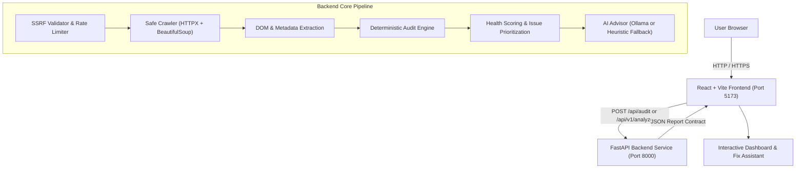

# SitePulse AI ⚡
> **Open-Source Website Health, SEO, Security & Accessibility Audit Agent powered by Open-Weight AI**

[](https://opensource.org/licenses/MIT)
[](https://www.python.org/)
[](https://fastapi.tiangolo.com/)
[](https://react.dev/)
[](https://vitejs.dev/)
[](https://tailwindcss.com/)
[](https://ollama.com/)

SitePulse AI is an open-source website intelligence and technical defect auditing platform designed for developers, agencies, and site owners. Enter any public website URL to instantly inspect on-page SEO, security headers, mobile accessibility, and performance metrics, calculate a deterministic health score, and generate plain-English prioritized fix recommendations with copy-paste code snippets.

---

## 📸 Key Features

- **🛡️ Multi-Domain Technical Inspection:**
  - **On-Page SEO:** Title bounds, meta description density, H1 heading hierarchy, canonical links, Open Graph & Twitter Cards, robots.txt, and sitemap detection.
  - **Security Hygiene:** HTTPS enforcement, Strict-Transport-Security (HSTS), Content-Security-Policy (CSP), Anti-Clickjacking (X-Frame-Options), MIME-sniffing prevention (X-Content-Type-Options), and Referrer-Policy.
  - **Accessibility & Mobile:** Viewport scalability, image missing alt attribute audit, HTML `lang` attributes, and WCAG 2.1 compliance indicators.
  - **Performance & Tech Stack:** Server response latency (TTFB), total page payload weight, and automatic technology stack fingerprinting (React, Next.js, WordPress, Nginx, Cloudflare, etc.).
- **📊 Weighted Health Scoring Engine:** Deterministic rule matrix calculating a 0–100 health score with letter grades (A+ to F) and severity ranking (Critical, High, Medium, Low).
- **🧠 Open-Weight AI Remediation Agent:** Powered by Google DeepMind's **Gemma 4** (`gemma4`) via **Ollama** (with full support for `gemma4:e4b`, `gemma4:12b`, `llama3.2`, `mistral`, `qwen2.5-coder`), backed by an automatic deterministic heuristic fallback.
- **💬 Interactive AI Chat Assistant:** Ask follow-up remediation questions about any finding directly within the dashboard.
- **🔒 Enterprise-Grade SSRF Protection:** Asynchronous DNS resolution blocking private RFC 1918 subnets, loopbacks, and cloud metadata services (AWS/GCP/Azure `169.254.169.254`).
- **⏱️ Sliding-Window Rate Limiting:** Enforces client IP rate limits to mitigate abuse and denial-of-service.
- **📄 Multi-Format Exporting:** 1-click Print / Save as PDF, full structured JSON, and GitHub-ready Markdown.

---

## 🏗️ Architecture



---

## 💻 Setup & Running Locally

### 1. AI Engine (Ollama + Gemma 4)

SitePulse AI defaults to Google DeepMind's **Gemma 4** (`gemma4`), delivering fast, flexible, and powerful reasoning with up to 256K context support and agentic tool use (replacing legacy Gemma 2):

```bash
# Pull and start Gemma 4 locally
ollama run gemma4

# Or for lightweight edge devices / lower memory:
ollama run gemma4:e4b
```

*(Note: If Ollama is not running, SitePulse AI automatically falls back to its deterministic rule heuristic engine without crashing).*

### 2. Backend (Python + FastAPI)

```bash
cd backend

# Create and activate virtual environment
python -m venv .venv
# Windows:
.\.venv\Scripts\activate
# macOS/Linux:
source .venv/bin/activate

# Install dependencies
pip install -r requirements.txt

# Run development server
python -m uvicorn app.main:app --host 127.0.0.1 --port 8000 --reload
```

- **Interactive API Docs (Swagger):** [http://127.0.0.1:8000/docs](http://127.0.0.1:8000/docs)
- **Alternative Docs (ReDoc):** [http://127.0.0.1:8000/redoc](http://127.0.0.1:8000/redoc)
- **Health Check Endpoint:** [http://127.0.0.1:8000/healthz](http://127.0.0.1:8000/healthz)

### 2. Frontend (React + Vite + Tailwind CSS)

```bash
cd frontend

# Install packages
npm install

# Run Vite dev server
npm run dev
```

The frontend dashboard will run at `http://localhost:5173/` and automatically proxies `/api/` requests to `http://127.0.0.1:8000`.

---

## 🧪 Automated Testing

SitePulse AI includes comprehensive test suites covering API contracts, audit algorithms, technology detection, and SSRF security defense:

```bash
cd backend
pytest -v
```

---

## 🛡️ Security & SSRF Defense Model

Public crawlers are inherently susceptible to Server-Side Request Forgery (SSRF). SitePulse AI employs defense-in-depth protections:

1. **Protocol Restriction:** Only `http://` and `https://` schemes are permitted. Schemes like `file://`, `ftp://`, and `gopher://` are rejected.
2. **Userinfo Stripping:** Embedded credentials (`user:pass@host`) are blocked.
3. **Async DNS & IP Verification:** All resolved host addresses are checked against IANA blocked network ranges:
   - Loopback (`127.0.0.0/8`, `::1`)
   - Private subnets (`10.0.0.0/8`, `172.16.0.0/12`, `192.168.0.0/16`)
   - Cloud instance metadata services (`169.254.0.0/16`, AWS/GCP/Azure)
   - Carrier-grade NAT (`100.64.0.0/10`)
4. **Redirect Hop Inspection:** HTTP redirects are inspected hop-by-hop up to 5 iterations. Each intermediate destination is verified before following, preventing open-redirect SSRF bypasses.
5. **Memory & Payload Budget:** Crawl responses are capped at 10MB to protect against decompression and memory exhaustion attacks.

---

## 📄 License

This project is licensed under the [MIT License](LICENSE).
